# ArenaFlow Prototype — Sơ Đồ Luồng & Chuyển Trạng Thái (Flows & State Transitions)

> Ngày lập: 18/11/2026 · Ngôn ngữ: Tiếng Việt · Phiên bản: 1.0-complete  
> Tài liệu thuộc bộ bàn giao UI Prototype ArenaFlow trong `docs/prototype/complete/`.

---

## 1. Cấu Trúc Điều Hướng Tổng Thể & Quy Tắc Phím Quay Lại (Navigation & Back Stack)

### 1.1. Sơ Đồ Điều Hướng Cấp Cao (High-Level Navigation Architecture)

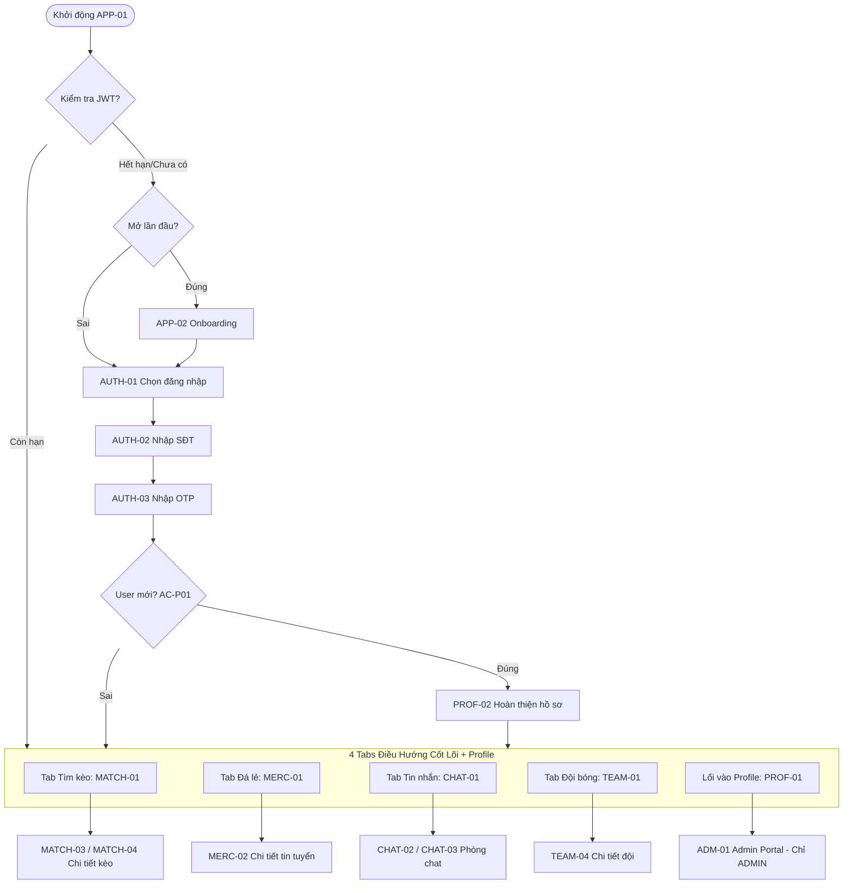

### 1.2. Ma Trận Xử Lý Phím Quay Lại (Back Button Behavior Matrix)

| Ngữ cảnh hiện tại | Hành động khi nhấn phím Back / Nút Quay lại | Hành vi dữ liệu & Giao diện |
|---|---|---|
| **Đang mở Modal Bottom Sheet hoặc Dialog** | **Đóng Sheet / Dialog trước tiên** | Không thay đổi màn hình bên dưới; giữ nguyên vị trí cuộn trang. |
| **Form đang nhập dở có thay đổi (`isDirty=true`)** | **Mở Dialog xác nhận hủy thay đổi** | Cảnh báo: "Bạn có thay đổi chưa lưu, bạn có chắc chắn muốn thoát?". Nếu chọn Có -> Hủy và Back. Nếu chọn Không -> Ở lại form. |
| **Chọn sân bóng từ form (`VEN-01`)** | **Quay lại Form tạo ban đầu (`MATCH-05` / `EXT-01`)** | **Bảo lưu 100% dữ liệu đã nhập trước đó** (ngày, giờ, chi phí, trình độ), tự động điền ID sân vừa chọn vào trường sân đấu. |
| **Phiên hết hạn khi đang thao tác (`AUTH-06`)** | **Đưa về màn hình đăng nhập, lưu `redirectUrl`** | Sau khi xác thực thành công -> Tự động điều hướng trở lại đúng màn hình/sheet đích ban đầu nếu còn hợp lệ. |
| **Chuyển tab dưới thanh Bottom Navigation** | **Bảo tồn trạng thái từng tab** | Mỗi tab duy trì back stack độc lập, giữ nguyên trạng thái cuộn (scroll position) và bộ lọc đang áp dụng. |
| **Khu vực Quản trị Admin (`ADM-01..09`)** | **Thoát ra màn hình Hồ sơ cá nhân (`PROF-01`)** | Có TopAppBar và Breadcrumb riêng; cấm user thường quay lại bằng phím cứng. |

---

## 2. Các Máy Trạng Thái Cốt Lõi (Core State Machines)

### 2.1. Vòng Đời Kèo Đấu (Match Lifecycle State Machine)

Kèo đấu trải qua các trạng thái từ khi tạo đến khi kết thúc hoặc bị hủy:

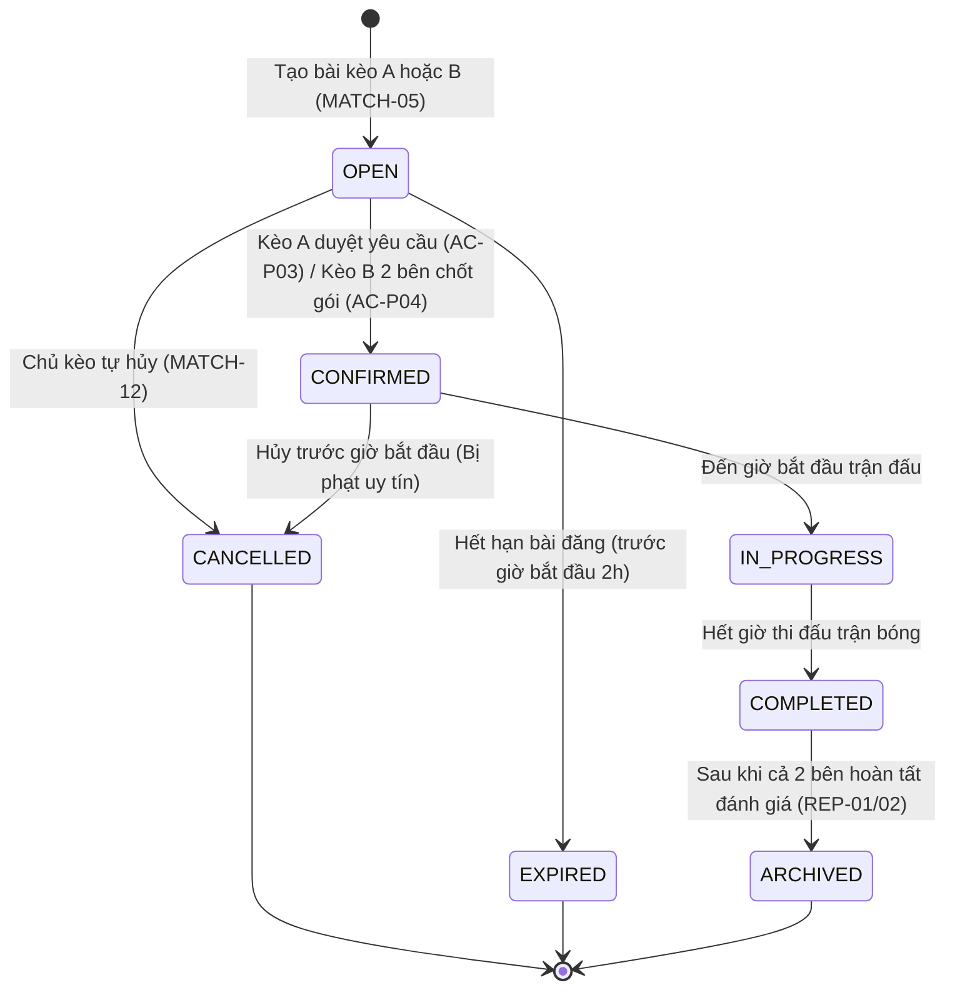

*Quy tắc nghiệp vụ cốt lõi:*
- **Chặn hủy sau giờ bắt đầu:** Khi trận đấu đã đến giờ bóng lăn, không bên nào được quyền bấm Hủy kèo.
- **Hủy có phạt uy tín:** Hủy kèo khi đang `CONFIRMED` sẽ kích hoạt tự động trừ điểm uy tín đội bóng (-15 điểm).
- **Trạng thái COMPLETED:** Mở cổng đánh giá đối phương (REP-01).

---

### 2.2. Vòng Đời Yêu Cầu Giao Lưu Kèo A (Match-A Request State Machine)

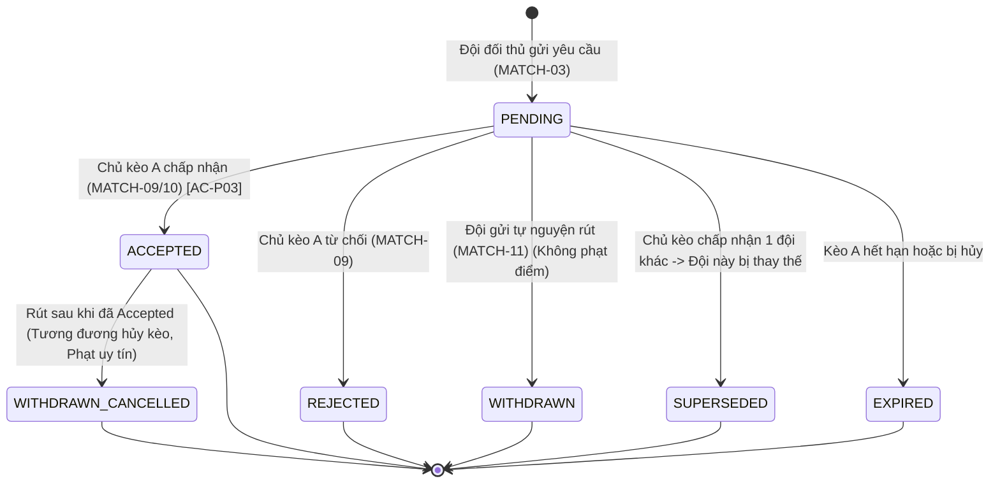

*Tiêu chí Acceptance Criteria AC-P03:*
> Khi Chủ kèo A chấp nhận một yêu cầu PENDING bất kỳ, yêu cầu đó chuyển thành `ACCEPTED`, kèo đấu chuyển sang `CONFIRMED`, và toàn bộ các yêu cầu PENDING khác của kèo này lập tức chuyển thành `SUPERSEDED`.

---

### 2.3. Vòng Đời Thương Lượng Kèo B & Chốt Gói (Pairing B Negotiation State Machine)

Mỗi đội nhận kèo B đều có một phòng thương lượng độc lập với Chủ kèo:

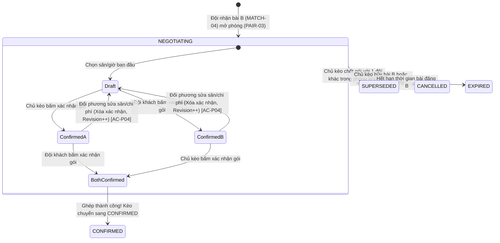

*Tiêu chí Acceptance Criteria AC-P04:*
> Nếu một bên đã bấm Xác nhận gói, bất kỳ thao tác chỉnh sửa phương án Sân/Giờ (`PAIR-04`) hoặc Chi phí (`PAIR-05`) từ phía đối phương sẽ lập tức làm tăng `revision` gói, hiển thị cảnh báo `PAIR-07` và **xóa toàn bộ xác nhận của cả hai bên**, buộc người dùng phải xem lại và tự tay bấm xác nhận lại.

---

### 2.4. Vòng Đời Đơn Ứng Tuyển & Tuyển Người Đá Lẻ (Mercenary State Machine)

#### a) Vòng đời Tin Tuyển của Đội (Recruitment Post):
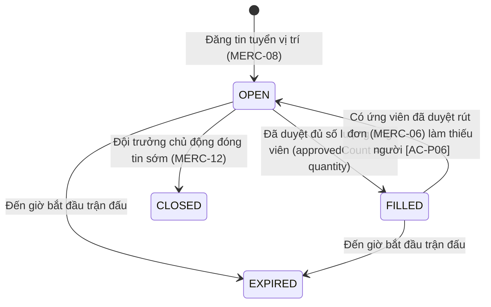

#### b) Vòng đời Đơn Ứng Tuyển (Application):
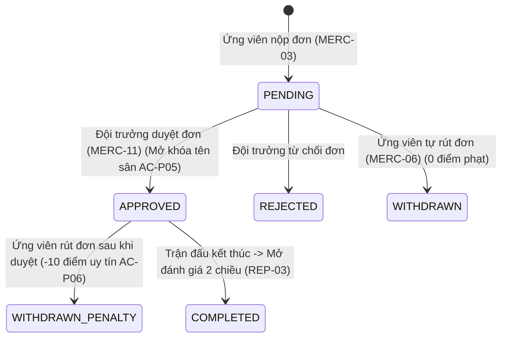

*Tiêu chí Acceptance Criteria AC-P05 & AC-P06:*
- **AC-P05 [PRIVACY]:** Khi đơn ở trạng thái `PENDING`, tuyệt đối không hiển thị tên sân, số nhà hoặc tọa độ trong `MERC-02`, `MERC-04` hoặc header phòng chat `CHAT-03`. Chỉ sau khi `APPROVED`, các trường thông tin này mới được mở khóa.
- **AC-P06 [WITHDRAWAL]:** Rút đơn lúc `PENDING` không bị trừ uy tín. Rút đơn khi đã `APPROVED` tự động trừ 10 điểm uy tín cá nhân và làm tin tuyển từ `FILLED` trở lại `OPEN`.

---

### 2.5. Vòng Đời Đội Bóng & Quyền Đội Trưởng (Team Lifecycle)

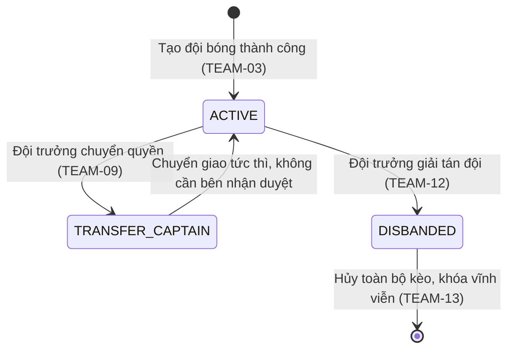

*Tiêu chí Acceptance Criteria AC-P02:*
> Nếu người dùng còn là Captain của ít nhất một đội bóng đang ở trạng thái `ACTIVE`, khi thực hiện hành vi Xóa tài khoản (`PROF-04`), hệ thống lập tức chặn lại và mở màn hình `PROF-05`, liệt kê các đội bóng liên quan và hướng dẫn chuyển quyền hoặc giải tán đội trước khi được xóa tài khoản.

---

### 2.6. Vòng Đời Báo Cáo Vi Phạm & Tranh Chấp (Report & Dispute State Machine)

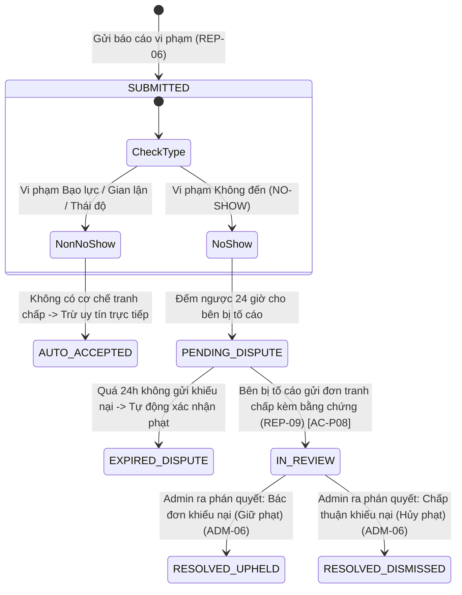

*Tiêu chí Acceptance Criteria AC-P07 & AC-P08:*
- **AC-P07 [BLIND RATING]:** Khi một bên vào xem kết quả đánh giá trận đấu (`REP-02`), nếu bên mình chưa gửi đánh giá (`REP-01`), giao diện hoàn toàn che giấu trạng thái nộp bài của đối phương. Chỉ khi cả hai bên đã nộp xong mới hiển thị công khai kết quả.
- **AC-P08 [DISPUTE LIMIT]:** Quyền gửi đơn tranh chấp (`REP-09`) **chỉ áp dụng duy nhất cho loại báo cáo NO-SHOW** và phải gửi trong vòng 24 giờ kể từ thời điểm báo cáo được lập. Mọi loại báo cáo khác đều bị khóa nút tranh chấp.

---

## 3. Sơ Đồ Chi Tiết 24 Hành Trình Nghiệm Thu (User Journeys J-01..J-24)

### 3.1. Luồng Xác Thực, Onboarding & Tài Khoản (J-01, J-02, J-03)

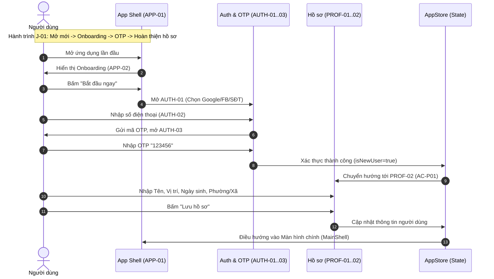

---

### 3.2. Luồng Quản Trị Đội Bóng & Chuyển Quyền (J-04, J-05, J-06)

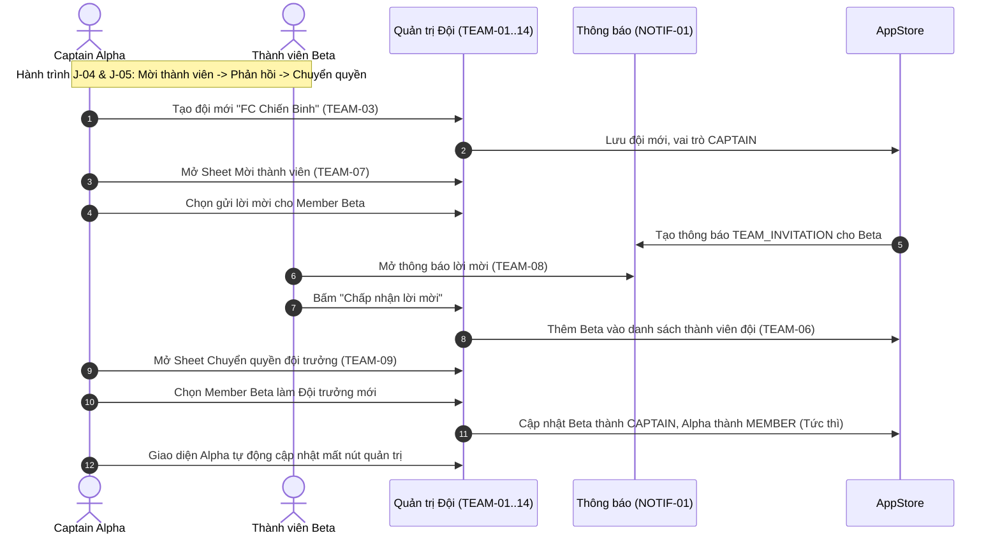

---

### 3.3. Luồng Tạo Kèo, Ghép Đội & Xung Đột Revision (J-07, J-09, J-10)

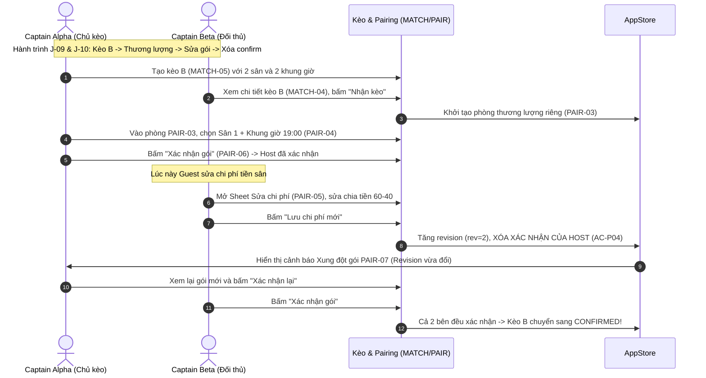

---

### 3.4. Luồng Tuyển Người Đá Lẻ & Bảo Vệ Riêng Tư Địa Điểm (J-12, J-13, J-14)

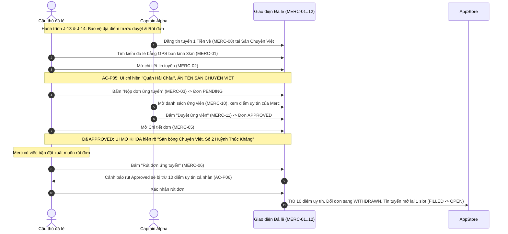

---

### 3.5. Luồng Sau Trận, Đánh Giá Ẩn & Tranh Chấp 24h (J-19, J-21)

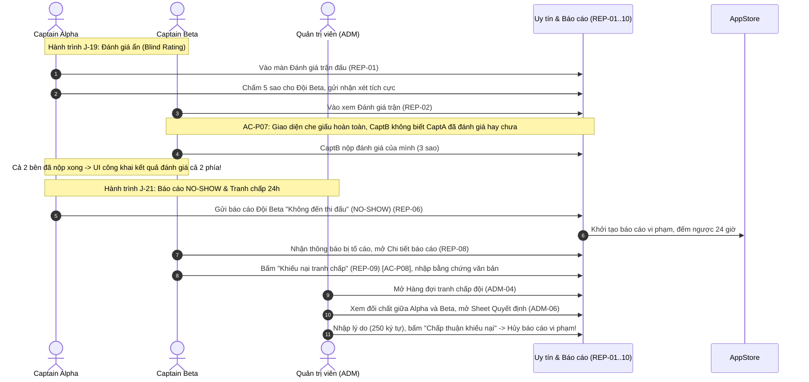
