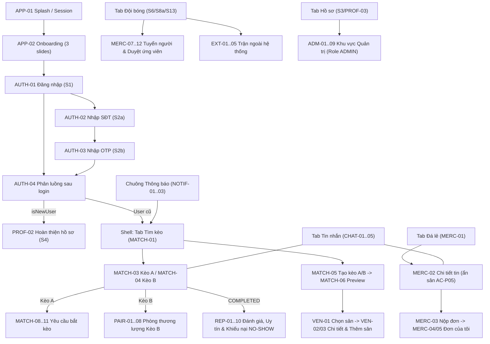

# Kế Hoạch Hoàn Thiện Prototype ArenaFlow Dựa Trên Bộ Ảnh `docs/prototype/images/`

> **Ngày lập:** 24/11/2026  
> **Mục tiêu:** Sửa toàn bộ điểm bị lệch trên prototype 16 màn hình hiện tại (`docs/prototype/index.html`), chuẩn hóa ngôn ngữ thiết kế từ 16 ảnh trong `docs/prototype/images/`, và mở rộng đầy đủ toàn bộ luồng (flow) + màn hình chi tiết của ứng dụng ArenaFlow (đối chiếu 101 IDs trong `docs/android-ui/screen-coverage.md`).

---

## 1. Kiểm Kê Hiện Trạng & Các Điểm Đang Bị Lệch

### 1.1. Những điểm bị lệch trong `docs/prototype/index.html` so với ảnh `docs/prototype/images/`

Qua kiểm tra trực tiếp mã nguồn `docs/prototype/index.html` và đối chiếu với các ảnh trong `docs/prototype/images/`:

| Màn hình | Vấn đề phát hiện trong `docs/prototype/index.html` | Ảnh hưởng thực tế khi mở trình duyệt | Cách khắc phục |
| :--- | :--- | :--- | :--- |
| **S2b** (`nhập mã xác thực .png`) | Dùng các class Tailwind chưa định nghĩa trong `tailwind.config`: `bg-brandDark`, `bg-brandBtn`, `border-brandBorderError`, `text-brandDark`, `text-brandError`, `rounded-custom` (8 chỗ). | Header mất nền xanh `#14532D`, nút *Xác nhận* mất nền `#3D6943` (bị trong suốt), 6 ô OTP mất viền đỏ, chữ lỗi mất màu đỏ. | Thay bằng token chuẩn (`bg-[#14532D]`, `bg-primary`, `border-error`, `text-error`, `rounded-[8px]`) hoặc khai báo bổ sung trong `tailwind.config`. |
| **S4** (`sửa hồ sơ.png`) | Dùng `<i data-lucide="...">` (6 icon: `arrow-left`, v.v.) và `rounded-custom` (13 chỗ) nhưng trang không import thư viện Lucide Icons. | Toàn bộ icon (bao gồm nút Back `←`) bị tàng hình; bo góc `rounded-custom` không có tác dụng. | Chuyển toàn bộ sang `Material Symbols Outlined` (đã import sẵn) và `rounded-[8px]`. |
| **S5** (`xóa tài khoản.png`) | Dùng `<i data-lucide="...">` (2 icon) không có thư viện Lucide. | Mất icon cảnh báo và nút điều hướng. | Chuyển sang `Material Symbols Outlined`. |
| **S3, S4, S5, S6, S8a, S8b, S9** | Thẻ `` avatar trỏ tới URL ngoài `https://lh3.googleusercontent.com/aida/...` (trong ảnh `hồ sơ cá nhân.png` và `chi tiết đội.png` cũng bị lỗi ảnh vỡ). | Hiện icon ảnh vỡ (broken image) trên Avatar cá nhân và đội trưởng. | Thay bằng Avatar SVG nội bộ / Initials Badge (`NVA`, `SM`) hoặc ảnh local trong `docs/prototype/assets/` kèm `onerror` fallback. |
| **S2a, S4, S8a, S13...** | Một số màn đặt cứng `w-[390px]` hoặc `min-h-screen` thay vì `w-full min-h-full` bên trong khung điện thoại `max-w-[390px]`. | Gây lệch lề ngang nhẹ hoặc thanh cuộn dọc không khớp khung `844px` khi nhúng vào shell. | Chuẩn hóa mọi view con dùng `w-full flex-1 flex flex-col`. |
| **S1, S2a, S2b** | Đang đóng băng ở trạng thái lỗi (S1 hiện banner lỗi + nút Google xoay spinner disabled; S2a/S2b hiện lỗi nhập sai). | Người dùng bấm thử không nhập liệu thật được, không thấy trạng thái mặc định sạch (Default state). | Tách rõ **Default state** (nhập được SĐT/OTP thật, bấm Google/Facebook có loading 600ms rồi vào app) và nút toggle xem **Error state** như trong ảnh. |

### 1.2. Khoảng trống về Flow và Màn hình chi tiết

- `docs/prototype/index.html` hiện **chỉ có 16 màn hình** (`S1`–`S14`), mới phủ được 3 mảng: **Auth (3 màn)**, **Hồ sơ (3 màn)**, **Đội bóng (10 màn)**.
- **Chưa có khung App Shell (Bottom Navigation Bar)** để kết nối các luồng chính sau khi đăng nhập.
- **Thiếu 85+ màn hình / sheet / trạng thái** thuộc 6 phân hệ cốt lõi của ArenaFlow (đối chiếu `docs/android-ui/screen-coverage.md`):
  1. Khởi động & Phân luồng (`APP-01..02`, `AUTH-04..06`, `PROF-03/05/06`)
  2. Khám phá, Tạo & Vòng đời Kèo A/B (`MATCH-01..14`)
  3. Thương lượng Kèo B (`PAIR-01..08`)
  4. Tuyển người đá lẻ & Trận ngoài hệ thống (`MERC-01..12`, `EXT-01..05`)
  5. Sân bóng & Địa điểm (`VEN-01..07`)
  6. Tin nhắn & Thông báo (`CHAT-01..05`, `NOTIF-01..03`)
  7. Sau trận, Uy tín & Tranh chấp (`REP-01..10`)
  8. Quản trị hệ thống Admin (`ADM-01..09`)
- Ghi chú hiện trạng `docs/prototype/complete/`: Thư mục này có sẵn các module JS (`store.js`, `router.js`, `fixtures.js`, `demo-panel.js`, `views/*.js`) nhưng **thiếu `index.html`** và dùng bộ màu/component cũ chưa đồng bộ 100% với ngôn ngữ thiết kế sắc nét của 16 ảnh `docs/prototype/images/` (header `#14532D` + vạch sân bóng SVG, surface `#F8FAF3`, typography `Be Vietnam Pro`).

---

## 2. Chuẩn Hóa Ngôn Ngữ Thiết Kế (Trích Xuất Từ `docs/prototype/images/`)

Mọi màn hình mới bổ sung phải tuân thủ tuyệt đối DNA thị giác của 16 ảnh gốc:
- **Màu sắc:**
  - Header thương hiệu / Hero Auth: `#14532D` (Deep Pitch Green) kết hợp họa tiết đường kẻ sân cỏ SVG mờ (`rgba(255,255,255,0.12)`).
  - Primary CTA & Active tab: `#3D6943` (hover `#315C38`), container nhạt `#BDEFBF` / `#EAF0E6`.
  - Background & Surface: `#F8FAF3` (nền app), `#FFFFFF` (card nổi bo `8px–12px`, viền `#E5E7EB` / `#DDE5D9`).
  - Text: `#111827` / `#2D342C` (tiêu đề), `#596158` (phụ đề/nhãn).
  - Semantic: Error `#DC2626` / `#A73B21` (nền `#FEF2F2`), Warning `#B45309` (nền `#FEF3C7`), Success `#16A34A` (nền `#F0FDF4`).
- **Typography & Icon:** `Be Vietnam Pro` (400, 500, 600, 700) + `Material Symbols Outlined` (không trộn Lucide/FontAwesome).
- **App Shell sau đăng nhập:**
  - Top App Bar trắng `h-14`: Nút Menu/Đội (`☰`), Logo `ArenaFlow`, Chuông thông báo (`NOTIF-01` có badge unread), Avatar (`PROF-01`).
  - **Bottom Navigation Bar (5 tab):**
    1. **Tìm kèo** (`MATCH-01`)
    2. **Đá lẻ** (`MERC-01`)
    3. **Đội bóng** (`TEAM-01` / `S6`)
    4. **Tin nhắn** (`CHAT-01`)
    5. **Hồ sơ** (`PROF-01` / `S3`)

---

## 3. Bản Đồ Flow Tổng Thể & Danh Mục Màn Hình Cần Hoàn Thiện

---

## 4. Kế Hoạch Triển Khai Chi Tiết Theo Từng Đợt

### Đợt 0: Sửa Lỗi Lệch & Chuẩn Hóa Nền Tảng 16 Màn Hình Gốc
- **Mục tiêu:** 16/16 màn hình trong `docs/prototype/index.html` khớp 100% về thị giác với `docs/prototype/images/` và tương tác mượt.
- **Công việc:**
  1. Sửa toàn bộ class bị thiếu trên `S2b` (`brandDark`, `brandBtn`, `brandBorderError`, `rounded-custom`), thay `data-lucide` trên `S4`, `S5` bằng `Material Symbols Outlined`.
  2. Thay toàn bộ link ảnh `lh3.googleusercontent.com` bị vỡ bằng Avatar SVG / Initials component dùng chung.
  3. Chuyển `S1`, `S2a`, `S2b` về trạng thái tương tác thật (Default + Validate form + nút toggle xem Error state).
  4. Chuẩn hóa kích thước `w-full` bên trong mobile frame `390x844` và cập nhật `docs/prototype/verify.cjs` kiểm tra không còn class lỗi hay `data-lucide` sót lại.

### Đợt 1: Khung App Shell, Điều Hướng & Hoàn Thiện Luồng Auth / Profile / Team
- **Mục tiêu:** Biến các màn hình rời thành một app có thể bấm đi xuyên suốt, bổ sung các màn/sheet còn thiếu của 3 nhóm đầu.
- **Màn hình cần thêm:**
  - `APP-01` (Splash & Session gate), `APP-02` (Onboarding 3 slides).
  - `AUTH-04` (Phân luồng user mới -> `S4`, user cũ -> Home), `AUTH-05` (Tài khoản đã xóa `AUTH_003`), `AUTH-06` (Sheet phiên hết hạn).
  - `PROF-03` (Menu tài khoản & cài đặt), `PROF-05` (Màn/Sheet chặn xóa tài khoản khi còn là Đội trưởng — liên kết sang `S10`/`S12`), `PROF-06` (Sheet đăng xuất).
  - `TEAM-01` vs `TEAM-02` (Tách rõ tab *Đội của tôi* và *Khám phá đội hệ thống*), `TEAM-05` (Sửa thông tin đội), `TEAM-08` (Phản hồi lời mời vào đội), `TEAM-14` (Sheet chọn đội đang thao tác khi làm đội trưởng nhiều đội).
- **Hạ tầng:** Xây dựng Router (hash/state stack hỗ trợ nút Back thật), Central Mock Store + Demo Switcher (đổi nhanh vai: Khách / User mới / Cá nhân / Captain / Member / Admin + Reset dữ liệu).

### Đợt 2: Luồng Trọng Tâm 1 — Khám Phá, Tạo Kèo & Vòng Đời Kèo A/B (`MATCH-01..14`, `PAIR-01..08`)
- **Mục tiêu:** Hoàn thiện luồng tìm kèo, đăng kèo A/B, duyệt yêu cầu kèo A và thương lượng chốt gói kèo B.
- **Màn hình cần thêm:**
  - **Tìm & Tạo kèo:** `MATCH-01` (Home Tìm kèo với filter ngày/loại kèo), `MATCH-02` (Sheet bộ lọc mở rộng), `MATCH-03` (Chi tiết kèo A), `MATCH-04` (Chi tiết kèo B nhiều option sân/giờ), `MATCH-05` (Form tạo kèo A/B), `MATCH-06` (Xem lại trước khi đăng).
  - **Quản lý kèo & Yêu cầu:** `MATCH-07` (Lịch thi đấu đội: Sắp tới / Kết thúc / Hủy), `MATCH-08..11` (Yêu cầu đã gửi / Gửi đến, Duyệt chấp nhận khiến yêu cầu khác `SUPERSEDED`, Rút yêu cầu), `MATCH-12..14` (Hủy kèo, Biến thể trạng thái vòng đời, Sửa chi phí kèo A).
  - **Thương lượng kèo B:** `PAIR-01..02` (Danh sách phòng thương lượng 2 phía), `PAIR-03..08` (Phòng thương lượng riêng, Chọn 1 sân + 1 giờ, Sửa chi phí & cọc, Xác nhận gói theo revision, Cảnh báo xung đột `409 PAIRING_006`, Trạng thái kết thúc `CONFIRMED`/`SUPERSEDED`).

### Đợt 3: Luồng Trọng Tâm 2 — Tuyển Người Đá Lẻ, Trận Ngoài & Sân Bóng (`MERC-01..12`, `EXT-01..05`, `VEN-01..07`)
- **Mục tiêu:** Hoàn thiện luồng cá nhân tìm/ứng tuyển đá lẻ và đội trưởng đăng tuyển/duyệt ứng viên, gắn với danh mục sân.
- **Màn hình cần thêm:**
  - **Cá nhân đá lẻ:** `MERC-01` (Khám phá tin tuyển theo bán kính GPS / khu vực), `MERC-02` (Chi tiết tin tuyển — **ẩn tên sân/địa chỉ trước khi duyệt AC-P05**), `MERC-03` (Sheet nộp đơn), `MERC-04..06` (Đơn của tôi, Chi tiết đơn `APPROVED` mở khóa sân & chat, Rút đơn cảnh báo `-10` uy tín).
  - **Đội trưởng tuyển người & Trận ngoài:** `MERC-07..12` (Chọn trận CONFIRMED hoặc trận ngoài, Đăng tin 1–4 vị trí, Quản lý tin tuyển, Duyệt/từ chối ứng viên, Sửa số lượng/đóng tin), `EXT-01..05` (Khai báo, Chi tiết, Sửa, Hủy, Thêm vị trí trận ngoài).
  - **Sân & Địa điểm:** `VEN-01..07` (Tìm & chọn sân từ form kèo/trận ngoài, Chi tiết sân, Thêm/Sửa sân, Thư viện ảnh sân, Báo cáo sân, Trạng thái sân `INACTIVE`).

### Đợt 4: Giao Tiếp & Vòng Đời Sau Trận (`CHAT-01..05`, `NOTIF-01..03`, `REP-01..10`)
- **Mục tiêu:** Khép kín trải nghiệm trước, trong và sau trận đấu.
- **Màn hình cần thêm:**
  - **Chat & Thông báo:** `CHAT-01` (Hộp thư), `CHAT-02..03` (Phòng chat 2 đội & chat Captain–Ứng viên), `CHAT-04..05` (Chế độ chỉ đọc khi kèo đóng/hết quyền, Sheet báo cáo tin nhắn), `NOTIF-01..03` (Trung tâm thông báo & xử lý điều hướng an toàn khi đích bị xóa/mất quyền).
  - **Sau trận & Uy tín:** `REP-01..03` (Đánh giá đối thủ blind rating, Đánh giá đá lẻ 2 chiều), `REP-04..05` (Thẻ uy tín đội & uy tín cá nhân), `REP-06..10` (Gửi báo cáo vi phạm, Danh sách & Chi tiết báo cáo, Khiếu nại `NO-SHOW` trong 24h, Kết quả tranh chấp).

### Đợt 5: Khu Vực Quản Trị Admin (`ADM-01..09`) & Kiểm Thử Tổng Thể
- **Mục tiêu:** Hoàn thiện cổng Admin và kiểm thử tự động toàn bộ 101 IDs.
- **Màn hình cần thêm:**
  - `ADM-01` (Trang tổng quan Admin — chỉ mở khi role `ADMIN`), `ADM-02..03` (Quản lý đội `mark-inactive`/`reactivate`, Lịch sử thành viên kèm tên thật user đã xóa), `ADM-04..06` (Hàng chờ tranh chấp đội & đá lẻ + Dialog ra quyết định), `ADM-07..09` (Hàng chờ báo cáo sân, Bật/tắt sân, Danh mục bộ môn).
- **Kiểm thử & Bàn giao:**
  - Mở rộng `docs/prototype/verify.cjs` (hoặc script Playwright) kiểm tra render tất cả route, không lỗi console, không broken image, không class CSS undefined, đi hết các luồng chính (Happy path + Error/Conflict/Permission states).
  - Cập nhật `docs/prototype/README.md` và đối chiếu đủ 101/101 IDs trong `docs/android-ui/screen-coverage.md`.
